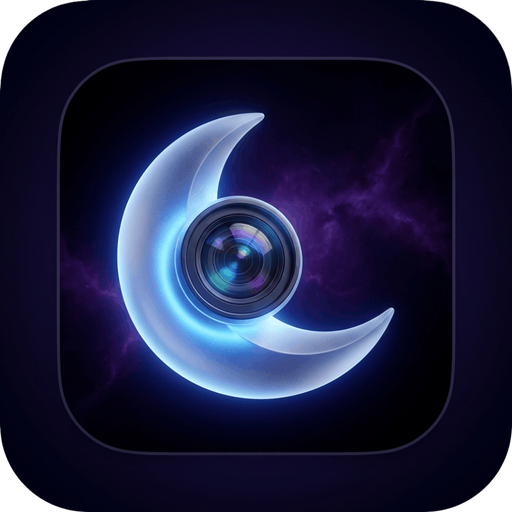
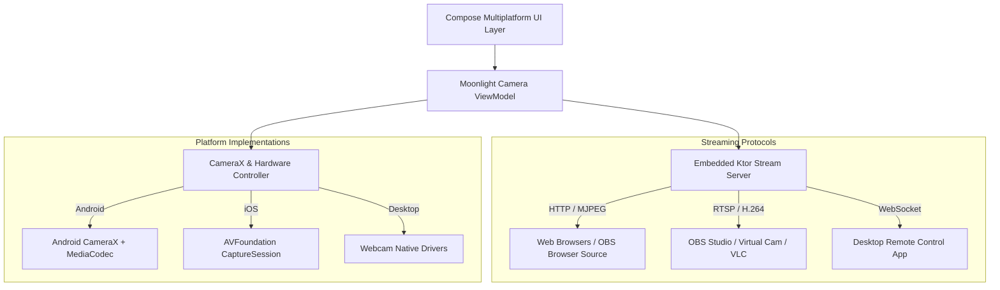

# 🌙 Moonlight Webcam — High-Performance Multiplatform Camera & RTSP Streaming Suite

<p align="center">
  
</p>


[](https://kotlinlang.org/)
[](https://www.jetbrains.com/lp/compose-multiplatform/)
[](https://developer.android.com/training/camerax)
[](https://ktor.io/)
[](#)

> **Moonlight Webcam** transforms your mobile device into an ultra-low-latency, professional-grade wireless webcam and RTSP/MJPEG video streaming hub. Built with **Kotlin Multiplatform (KMP)** and **Compose Multiplatform**, it delivers studio-quality video feeds, hardware-accelerated encoding, remote PTZ controls, and seamless desktop synchronization.

---

## 📑 Table of Contents
1. [Overview & Highlights](#-overview--highlights)
2. [Key Features](#-key-features)
3. [System Architecture](#-system-architecture)
4. [File & Directory Structure](#-file--directory-structure)
5. [Tech Stack & Libraries](#-tech-stack--libraries)
6. [Supported Platforms](#-supported-platforms)
7. [Installation & Getting Started](#-installation--getting-started)

---

## 🌟 Overview & Highlights

- **Ultra-Low Latency Video Pipeline**: Stream up to 4K 60fps video over local Wi-Fi, USB ADB tethering, or direct IP connections with sub-100ms latency.
- **Embedded Ktor Micro-Server**: Runs an autonomous HTTP/WebSocket server directly on the mobile device for zero-config browser and OBS integration.
- **Cross-Platform Client Engine**: Shared business logic and UI across **Android**, **Desktop (macOS / Windows / Linux)**, and **iOS**.
- **CameraX Hardware Control**: Full manual control over ISO, exposure compensation, white balance, focal length, torch, and optical stabilization.

---

---

## 📱 App Screenshots

<p align="center">
  <table>
    <tr>
      <td align="center" width="25%">
        <br />
        <b>1. Main Screen</b>
      </td>
      <td align="center" width="25%">
        <br />
        <b>2. Core Experience</b>
      </td>
      <td align="center" width="25%">
        <br />
        <b>3. Interactive Mode</b>
      </td>
      <td align="center" width="25%">
        <br />
        <b>4. Advanced Features</b>
      </td>
    </tr>
    <tr>
      <td align="center" width="25%">
        <br />
        <b>5. Workflow / Details</b>
      </td>
      <td align="center" width="25%">
        <br />
        <b>6. Studio Console</b>
      </td>
      <td align="center" width="25%">
        <br />
        <b>7. Settings & Config</b>
      </td>
      <td align="center" width="25%">
        <br />
        <b>8. Dark & Light Theme</b>
      </td>
    </tr>
  </table>
</p>

---

## 🚀 Key Features

### 📹 Professional Camera Controls
- **Lens Selection**: Seamless switching between Ultra-Wide, Wide, Telephoto, and Front-facing cameras.
- **Manual Optics**: Touch-to-focus with lockable AE/AF, manual ISO slider (100–3200), and custom shutter speeds.
- **Orientation Awareness**: Adaptive sensor rotation with portrait, landscape, and upside-down mounting modes.

### 🌐 Streaming & Connectivity
- **MJPEG & RTSP Feeds**: Compatible with OBS Studio, vMix, VLC, Zoom, Teams, and Google Meet.
- **USB Tethering Mode**: Ultra-reliable wired connection via ADB reverse port forwarding.
- **LAN Discovery & QR Connect**: Instant device pairing via dynamic QR code generation.
- **Virtual Background & Shader Filters**: Real-time LUT filters, monochrome preview, and low-light night enhancement.

### 🔋 Battery & Thermal Protection
- **Background Foreground Service**: Prevents OS process death during long streaming sessions.
- **OLED Sleep Mode**: Black screen overlay with dimmed battery telemetry to reduce thermal throttle.

---

## 🏛 System Architecture

Moonlight Webcam uses **MVI / Unidirectional Data Flow** with clean source separation across shared and platform modules:



---

## 📂 File & Directory Structure

```text
MoonlightWebcam/
├── build.gradle.kts                      # Root Gradle configuration
├── settings.gradle.kts                   # Project module definitions
├── gradle/libs.versions.toml             # Shared dependency version catalog
├── composeApp/                           # Shared KMP Core Module
│   └── src/
│       ├── commonMain/                   # Multiplatform UI, ViewModels & Ktor Server
│       ├── androidMain/                  # CameraX bindings, foreground service, manifest
│       └── iosMain/                      # iOS AVFoundation camera bridge
├── desktopApp/                           # Desktop client & virtual camera receiver
└── iosApp/                              # Xcode project wrapper for iOS target
```

---

## 🛠 Tech Stack & Libraries

| Technology | Purpose |
|---|---|
| **Kotlin Multiplatform** | Unified business logic and camera pipeline orchestration |
| **Compose Multiplatform** | Declarative desktop, mobile, and web user interfaces |
| **AndroidX CameraX** | Hardware-accelerated camera capture, autofocus, and zoom |
| **Ktor Server** | Embedded high-throughput micro-server for live streaming |
| **Kotlinx Coroutines & Flow** | Asynchronous frame rendering and state streaming |
| **AndroidX WorkManager** | Background housekeeping and diagnostics |

---

## 📱 Supported Platforms

- **Android**: API 24+ (Android 7.0 to Android 14+).
- **Desktop**: macOS (Intel & Apple Silicon), Windows, and Linux.
- **iOS**: iOS 15.0+ via Compose Multiplatform.

---

## 💻 Installation & Getting Started

```bash
# Clone the repository
git clone https://github.com/I-am-Manu-Singh/MoonlightWebcam.git

# Build and install Android client
./gradlew :composeApp:installDebug

# Run Desktop client
./gradlew :desktopApp:run
```

---

## 👤 Author
**Manpreet Singh** ([@I-am-Manu-Singh](https://github.com/I-am-Manu-Singh)) · **Creative Bliss Labs**


---
